<div align="center">
  <picture>
    <source media="(prefers-color-scheme: dark)" srcset="docs/brand/logo-dark.svg">
    
  </picture>
  <h1>Excubitor</h1>
  <p><strong>AI night-watch for your infrastructure — from raw alert to published post-mortem, in one console.</strong></p>
  <p>
    <a href="https://github.com/Naveenbtnk/Excubitor/actions/workflows/ci.yml"></a>
    
    
    
    
  </p>
  <p><strong>Live demo:</strong> <em>none hosted — two commands to your own.</em> <code>cp backend/.env.example backend/.env</code>, then <code>docker compose up --build -d</code>. Nothing but the Gemini key is required, and <code>DEMO_ACCOUNT_ENABLED=true</code> publishes a read-only login your visitors can use. Every screenshot below, and the <a href="docs/excubitor-demo.mp4">46-second walkthrough video</a> with them, came from exactly that stack.</p>
</div>

---

## The problem it solves

On-call engineers drown in alerts that say *that* something broke and rarely *why*. The context
needed to understand one — the runbook, the last deploy, the thing someone fixed six months ago —
lives in five different tools. And the post-mortem that should turn one bad night into a permanent
fix rots in a Google Doc nobody opens again.

Excubitor carries one signal through the whole cycle and keeps the accounting honest at every step:

| The pain | What Excubitor does |
| --- | --- |
| Alerts arrive faster than anyone can read them | Alertmanager webhooks and simulated alerts land in one queue; one click runs Gemini triage and produces an incident with a root cause, a recommendation and a confidence score. |
| The context behind a decision is scattered | Triage retrieves the pages of *your* runbooks that match the alert (pgvector embeddings), so the recommendation arrives with the evidence that shaped it. |
| "What happened to this incident?" has no answer an hour later | Every status change, reassignment, comment and post-mortem transition is an append-only timeline entry, written in the same transaction as the change it records. |
| A post-mortem is a blob someone pastes into a doc and abandons | It is a workflow: generated as a draft with structured sections, reviewed, published, exported as markdown — with follow-ups stored as rows carrying owners and due dates, counted by the Overview when they go overdue. |
| Nobody knows whether the AI bill is affordable until it 429s | Per-user rate limits and a project-wide provider budget share one set of counters; `GET /health/llm` reports the allowance before it is spent. |

## Architecture

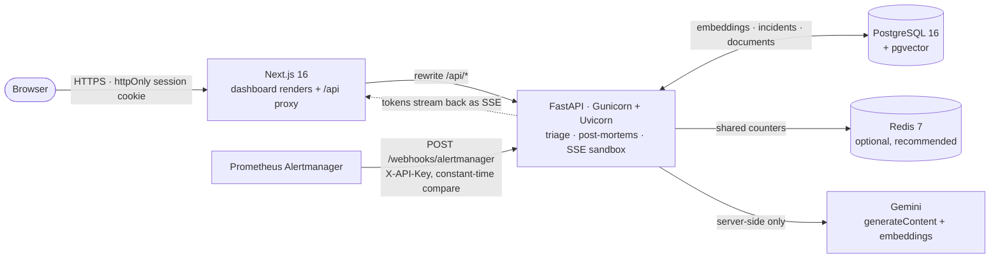

The dashboard never talks to the database or the provider. Next.js proxies `/api/*` to the API,
which keeps the session cookie first-party, keeps the Gemini key out of the browser entirely, and
means the only thing that needs to be published is the frontend. The API is a stateless
Gunicorn/Uvicorn process; PostgreSQL holds the only durable state, and Redis holds the counters
behind the rate limits and the provider budget.

Reads and writes all pass through one FastAPI dependency that resolves the caller's role, so the
UI is a convenience layer rather than the control: hiding a button spares a click, and the route
decides what happens.

<details>
<summary>Plain-text version of the diagram</summary>

```
Browser ──HTTPS──▶ reverse proxy ──▶ Next.js (3000) ──/api/*──▶ FastAPI (8000) ──▶ PostgreSQL 16 + pgvector
                                          │                            ├──▶ Redis (counters, optional)
                                          │                            └──▶ Gemini (server-side only)
                                          └── renders the dashboard, proxies /api/*, relays the SSE stream

Alertmanager ──POST /webhooks/alertmanager (X-API-Key)──▶ FastAPI
```

</details>

**Stack.** Next.js 16, React 19, Tailwind CSS 4, SWR, React Markdown · FastAPI, async SQLAlchemy,
Alembic · PostgreSQL 16 with pgvector · Redis 7 for shared counters · Gemini (`gemini-3.8-flash`
and `gemini-embedding-001`) · JWT authentication in an httpOnly cookie · Docker Compose for the
full local production stack.

## Feature gallery

**[Walkthrough video — 46 seconds](docs/excubitor-demo.mp4)** (1440×900, 0.7 MB). The whole
cycle against the running stack, with no cuts: sign in, read the day at a glance, watch the sandbox
answer stream in and stop it with the partial answer kept, then open a post-mortem in review and
download its markdown. The stills below are the same session, one screen at a time.

| | |
| --- | --- |
| 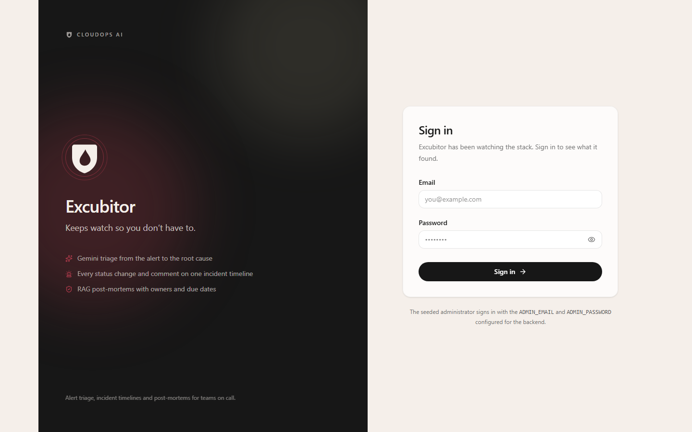<br>**A front door, and no way around it** — one sign-in route and no self-service registration; the first administrator comes from environment variables. | 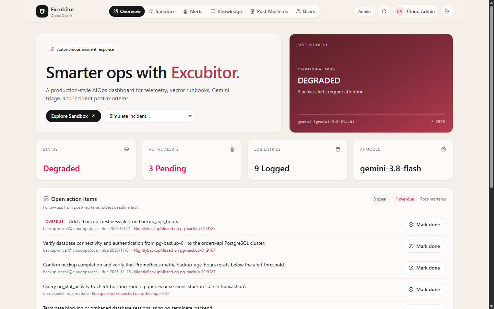<br>**The day at a glance** — alert queue, the model in use and outstanding post-mortem follow-ups on one screen, with open and overdue counted across every document you may read. |
| 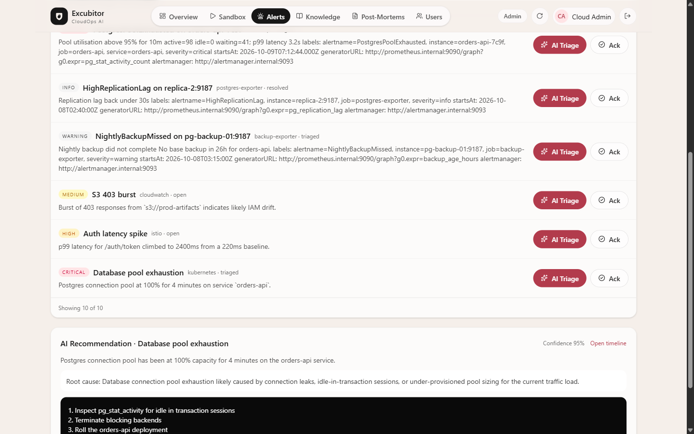<br>**Triage with evidence** — one click turns an alert into an incident with a root cause, a recommendation and a confidence score, retrieved from your own runbooks. | 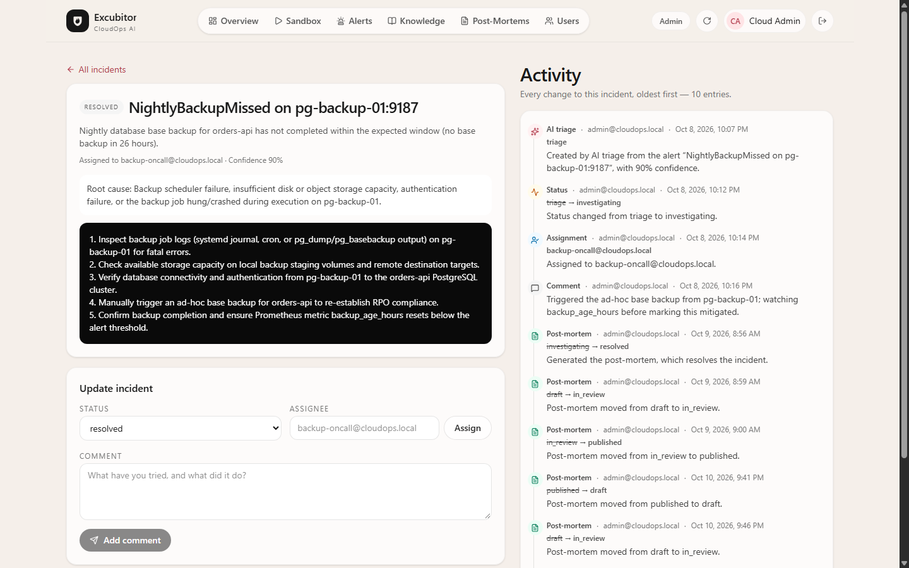<br>**An incident with a memory** — status changes, reassignments and comments are append-only entries naming who and when; a change that changes nothing writes nothing. |
| 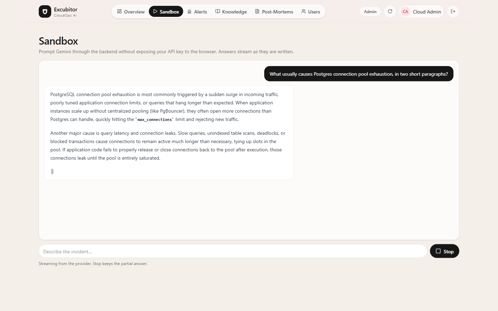<br>**Answers as they are written** — tokens stream over SSE, **Stop** keeps the partial answer, and a spent budget arrives as a sentence with a real countdown instead of the provider's payload. | 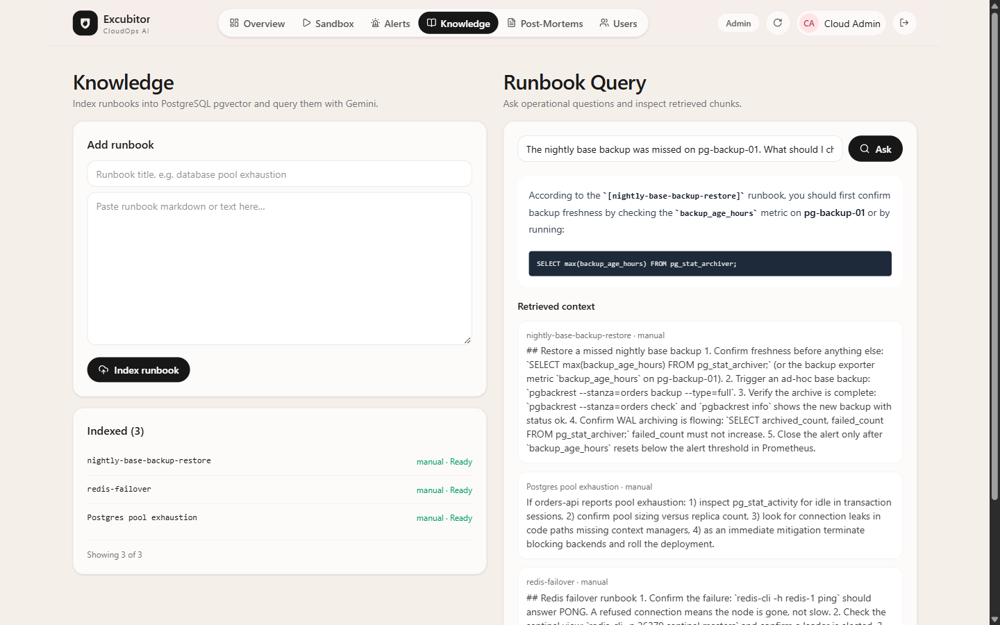<br>**Your runbooks, retrieved** — pages are chunked, embedded and matched by vector similarity, which is what lets triage cite your operations docs. |
| 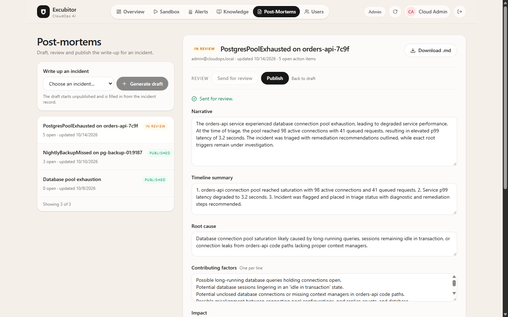<br>**A document a team signs off** — Draft → in review → published, one transition at a time from controls carried on the document itself; the generated narrative sits beside the structured sections a reviewer works through, with the open follow-up count in the header. | 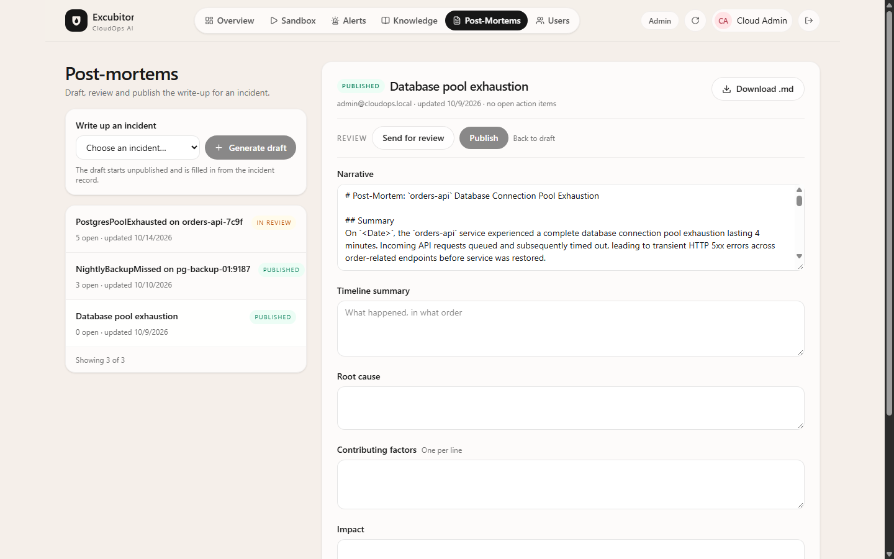<br>**A review queue, not a blob store** — most recently touched first, each row carrying its status and open follow-up count, and the export is a markdown file whose empty sections read `_Not recorded._`. |
| 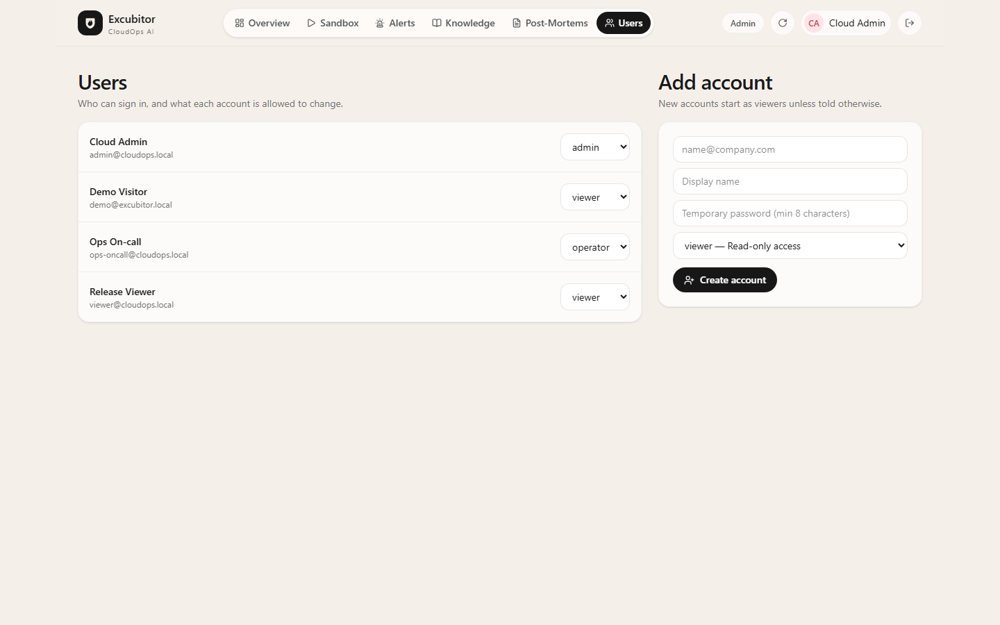<br>**Roles are rows** — admin, operator and viewer are enforced per route and read on every request, so a demotion lands immediately and a hidden button is only a courtesy. | 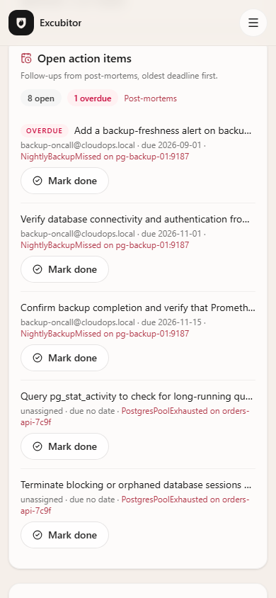<br>**The queue in your pocket** — the console is usable down to 390 px, for the 3 a.m. check. |
| 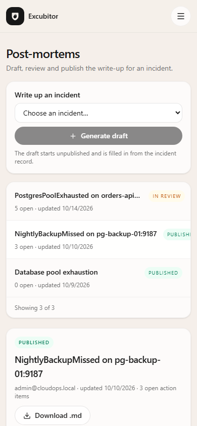<br>**The document on a phone** — reading and reviewing do not require a desk. | <a href="docs/excubitor-demo.mp4"></a><br>**[The whole cycle, in 46 seconds](docs/excubitor-demo.mp4)** — the same stack as every still above, with no cuts. |

## Why these choices

The decisions a reviewer would otherwise have to reverse-engineer, and the reasoning behind them.

| Decision | Why it is this way |
| --- | --- |
| **The provider budget counts upstream attempts, not HTTP requests** (`app/services/llm/quota.py`) | Attempts are what the provider bills. One user request can fan out into several calls (a long runbook embeds once per chunk) and every replayed retry is another paid request, so counting requests would under-report real usage. |
| **Rate-limit and budget counters are Lua scripts, not read-modify-write** (`app/core/counter_store.py`) | Two workers could both observe a count below the limit and both be allowed. A Lua script is serialized by Redis, and `TIME` comes from the server, so worker clock skew cannot widen a window. With `REDIS_URL` unset the same interface keeps the counters in-process, which is correct for exactly one worker. |
| **Provider failures are projected once, at one seam** (`app/services/llm/errors.py`) | A Gemini 429 body is roughly a kilobyte of JSON naming quota ids, the model and the project. One projection turning any failure into `{code, provider, wait, request_id}` means no route can leak the provider's text, and the user-facing wording lives in one tested place. |
| **The SSE stream sets `Cache-Control: no-transform`** (`app/api/routes/sandbox.py`) | The Next.js proxy gzips by default, and a gzip encoder buffers until it has a block to emit — every token would arrive as one lump at the end. Browsers always send `Accept-Encoding` and curl does not, so the bug is invisible to every convenient test and fixed by one header. |
| **Only what is safe to replay is replayed** (`app/services/llm/retry.py`) | Transient failures (5xx, timeouts, dropped connections) retry with full jitter; a `429 RESOURCE_EXHAUSTED` does not, because the window outlives the request and a retry spends more quota. A stream replays only before the first token, and the SDK's own retries are disabled, so a retry can never duplicate a paid request or a piece of text. |
| **Roles are enforced by the route, never by the UI** (`app/api/deps.py`) | Every write route declares its minimum role in a FastAPI dependency and reads it from the user row per request. Hiding a button only spares a click — a Viewer calling a write route directly gets `403` — and a demotion lands on the next request instead of the next login. |
| **The incident timeline is written in the same transaction as the change it records** (`app/services/timeline.py`) | An event committed separately could survive a change that rolled back, turning the history into a second opinion about the incident rather than a record of it. The helper deliberately does not commit; the caller's transaction covers both. |
| **The proxy's patience is arithmetic the service can state** (`app/core/config.py`) | Worst-case wall time is attempts × per-attempt deadline plus backoff, exposed as `retry_budget_seconds`. `PROXY_READ_TIMEOUT_SECONDS` records what the proxy was configured with, and the startup guard names both numbers when they disagree — so "the proxy gave up first" is caught at boot instead of as a mystery 502. |

## Hard numbers

| | |
| --- | --- |
| **Backend** | **325 tests**, `pytest -q` in ~1 m 45 s — unit tests plus integration tests against a real PostgreSQL 16 + pgvector and a real Redis. |
| **Frontend** | **103 tests** across 14 files (`vitest run`), plus `tsc --noEmit` and a production `next build`. |
| **CI** | One workflow, three jobs. Five checks block a commit from a green build: `ruff`, `pytest`, `tsc`, `vitest`, and `npm audit --omit=dev --audit-level=high`; the Docker images build only after all of them pass. |

```bash
# Backend: lint, then the full suite (needs PostgreSQL on 5434 — see docs/development.md)
cd backend
# Windows PowerShell: .venv\Scripts\Activate.ps1
source .venv/bin/activate
ruff check app tests && pytest -q

# Frontend: types, tests, production build
cd frontend && npm run typecheck && npm test && npm run build
```

The backend suite swaps the LLM for a deterministic offline fake, so tests never spend a paid API
call. The tests that prove the shared counters hold *across workers* need a real Redis — they fail
CI rather than report a pass they did not earn when it is missing.

## Quickstart

Requirements: Docker with Compose, and a Gemini API key (or `LLM_PROVIDER=ollama` against a local
runtime — nothing else needs a paid account).

```bash
# 1. Configuration. Every setting is documented in the file itself.
cp backend/.env.example backend/.env

# 2. The three values that matter. Generate the secret; do not invent one by hand.
python -c "import secrets; print(secrets.token_urlsafe(48))"   # -> JWT_SECRET
#    ADMIN_PASSWORD  -> the login you will use below
#    GEMINI_API_KEY  -> from aistudio.google.com (server-side only, never sent to a browser)

# 3. Start everything: PostgreSQL + pgvector, Redis, the API and the dashboard.
docker compose up --build -d

# 4. Wait for health, then look at it. The database is migrated on first boot.
until curl -fsS http://localhost:8010/health > /dev/null; do sleep 2; done
curl -fsS http://localhost:8010/health | jq   # {"status":"ok","database":"ok","counters":"ok",...}
```

Open <http://localhost:3000> and sign in with `ADMIN_EMAIL` / `ADMIN_PASSWORD`. From there:

1. **Overview** — simulate an alert from the dropdown; it appears in the queue below, and the
   action-items strip carries the outstanding post-mortem follow-ups.
2. **Alerts** — run **AI Triage** on it. The recommendation appears with a link to the incident's
   timeline.
3. **Incident timeline** — reassign it, comment, move its status; every change is recorded with
   your name.
4. **Knowledge** — paste a runbook and index it, then ask a question and watch the retrieved
   context come back with the answer.
5. **Sandbox** — ask anything and watch the answer arrive token by token, with a **Stop** that
   keeps the partial answer.
6. **Post-Mortems** — generate a markdown post-mortem from an incident, edit its sections, move it
   to **In review**, publish it, and download the `.md`.

Demo alerts appear on a fresh database outside production. Set `SEED_DEMO_DATA=false` to start with
an empty queue instead. In production, `ENVIRONMENT=production` enables a startup guard: a missing
or still-default `JWT_SECRET`, an empty `ADMIN_PASSWORD`, a missing Gemini key or `DEBUG=true`
stop the process with a message naming what to fix, and weak-but-present values are logged by name
(never by value) as `insecure_setting`.

Services:

| Service | Address |
| --- | --- |
| Dashboard | `http://localhost:3000` |
| API | `http://localhost:8010` |
| API health | `http://localhost:8010/health` |
| PostgreSQL / pgvector | `localhost:5434` |
| Redis | `localhost:6379` |

## First steps after deploying

The seeded administrator exists so the first sign-in works, not so it stays. Do this before you
point anyone else at the deployment.

1. **Set `ADMIN_PASSWORD` before the first boot, and treat it as one-shot.** The value seeds the
   account on the first start and the startup guard refuses to start in production with it empty or
   still set to the value shipped in `.env.example`. Changing the variable later does not change the
   stored password — the seeding is *insert if absent* — so rotate it from the **Users** page once
   the app is up, and keep the environment value as the bootstrap credential.
2. **Sign in with `ADMIN_EMAIL` / `ADMIN_PASSWORD`, then create your own admin.** *Users* → **Add
   user**, role **Admin**, the address and name you actually use. Passwords are hashed on the way
   in and never leave the database in a readable form.
3. **Sign in as your own account and demote the seeded one.** *Users* → the seeded row → **Viewer**.
   The API refuses to demote the last administrator
   (*"This is the last administrator; promote someone else before changing this role."*) — that guard
   is why step 2 comes first, and it is the difference between a demotion and locking every human out
   of your own deployment.
4. **Delete the seeded account.** `DELETE /users/{id}` is administrator-only, and it refuses both the
   caller's own account and the last administrator — with step 3 done, the seeded row can go without
   leaving a deployment nobody can administer ([docs/api.md](docs/api.md) has the call). The Users
   page does not expose a delete control yet; if you would rather work in PostgreSQL:

   ```bash
   docker compose exec db psql -U cloudops -d cloudops_ai \
     -c "DELETE FROM users WHERE email = 'admin@cloudops.local';"
   ```

5. **Decide about the public demo deliberately.** `DEMO_ACCOUNT_ENABLED=true` requires
   `DEMO_ACCOUNT_PASSWORD`, provisions a shared **Viewer** login at `DEMO_ACCOUNT_EMAIL`, publishes
   that credential at `GET /auth/demo` (which is what the sign-in page's **Try the demo** button
   uses) and gives it one shared AI allowance of `DEMO_ACCOUNT_RATE_LIMIT` calls per
   `LLM_QUOTA_WINDOW_SECONDS`. Anyone who can reach the deployment may read it as that account; the
   startup log says so on every boot. Leave it unset for a private deployment.

## Going deeper

| Document | What is in it |
| --- | --- |
| [docs/api.md](docs/api.md) | Route-by-route conventions: the pagination envelope, the append-only incident timeline, the post-mortem workflow and export, Alertmanager ingestion. |
| [docs/reliability.md](docs/reliability.md) | Rate limits, the provider budget, the retry/timeout taxonomy, the SSE `no-transform` fix, error projection, observability. |
| [docs/development.md](docs/development.md) | Local development, verification (including the Redis-dependent tests), CI jobs. |
| [DEPLOYMENT.md](DEPLOYMENT.md) | The path to production: secrets, the startup guard in full, HTTPS with Caddy and nginx (including the stream-safe and provider-safe read timeouts), Gunicorn sizing against your connection budget, private Redis, backups, upgrades, troubleshooting. |
| [ENGINEERING-LOG.md](ENGINEERING-LOG.md) | What exists and how it was verified, the decisions behind the non-obvious parts, and what is deliberately still unbuilt. |

## Security model

- **Gemini is only called from FastAPI.** The API key never reaches a browser; the dashboard talks
  to `/api/*` and nothing else.
- **The dashboard sits behind a signed, httpOnly session cookie**, and there is no public
  registration route. The first admin comes from environment variables.
- **Three roles — `admin`, `operator`, `viewer` — are enforced by a FastAPI dependency on every
  route**, read from the user row on every request. A Viewer calling a write route directly gets
  `403`; the UI only hides the button.
- **The API schema is a development aid.** `/docs`, `/redoc` and `/openapi.json` are served
  outside production and off by default in production (`EXPOSE_API_DOCS`), so a deployment
  describes itself through the dashboard instead of handing a stranger a map of every route,
  parameter and response shape.
- **A production deployment is checked before it serves anything.** A missing secret stops the
  process at startup rather than silently defaulting to a value published in this repository; a
  weak one is logged by name, never by value.
- **Unexpected failures never leak internals.** An exception that escapes a route becomes a JSON
  `500` with a stable `internal_error` code and a request id matching the log line holding the
  traceback; the same contract applies inside the SSE stream, where the status line is already
  committed.
- **`POST /webhooks/alertmanager` compares its shared token in constant time** and answers `503`
  rather than accepting anything when that token is unset.
- **The optional demo login is a Viewer, and its credential is public on purpose.** The server
  provisions it at startup, serves it from `GET /auth/demo` so the sign-in page can prefill it,
  forces the role back to Viewer on every boot (a promotion made in the UI does not survive a
  restart) and gives it one shared AI allowance so a single visitor cannot spend the day's budget.
  Serve it only where a stranger reading your demo data is acceptable.
- Do not commit `backend/.env`; set `COOKIE_SECURE=true` and restrict `CORS_ORIGINS` for HTTPS
  deployments.

## Known limitations

- **The apple-touch-icon is an SVG, and iOS wants a PNG.** The mark is hand-written SVG on
  purpose — no binary assets in the tree — so `public/apple-touch-icon.svg` is what the link
  points at. Browsers that accept an SVG touch icon use it; iOS falls back to a screenshot of
  the page. Generating the PNG sizes is a build step that has not been added.
- **Webhook ingestion does not dedupe yet.** Alertmanager re-sends a group on every
  `repeat_interval` and again when it resolves, and each delivery creates new alert rows, so a
  long-firing alert appears once per notification. `POST /webhooks/alertmanager` accepts the
  fingerprint field and ignores it. Coalescing on it needs one decision first — whether a
  `resolved` notification should close the original row or reopen it — and that is a design call
  rather than a missing line of code, so it is not half-implemented here. Until then, treat the
  alert list as a delivery log rather than a current-state table. The behaviour is pinned by
  `test_a_repeated_delivery_creates_the_alerts_again` so a fix has something to change.

## Credits

Every screenshot in this README, and the walkthrough video, was captured from the local Docker
Compose stack at 1440×900 (desktop) and 390×844 (mobile), signed in as the seeded administrator
against the seeded demo data. No credentials, tokens or provider payloads appear in any of them. The mark
is hand-drawn SVG, and the rest of the visual system is Tailwind CSS 4 with the two brand colours
defined in `frontend/app/globals.css`.

## License

MIT — see [LICENSE](LICENSE).
